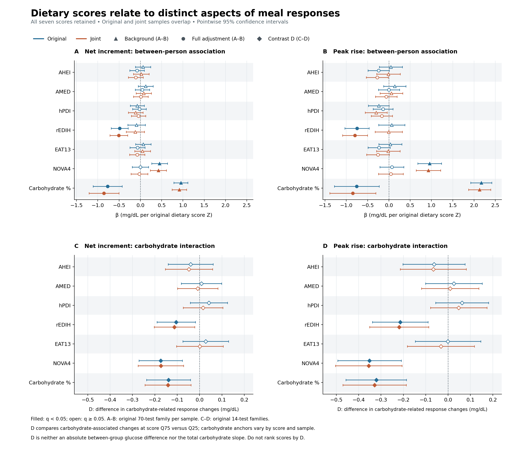
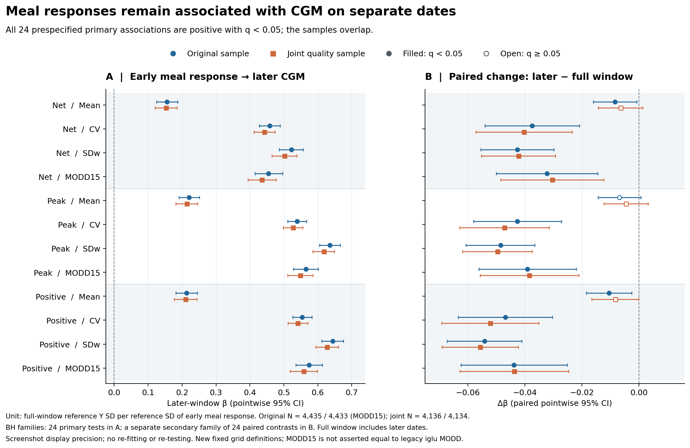
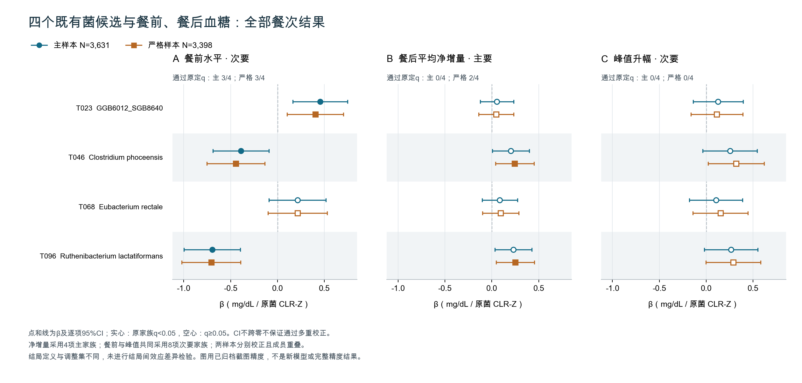

# HPP 餐前餐后血糖探索：研究总结与结果说明

**研究整理范围：2026-09-24—2026-09-29；真实结果证据截至 2026-09-29 14:07。**

这份总结面向组内协作，说明本目录做了什么、采用什么方法、哪些结果有支持，以及目前能解释到哪里。它整合八个已运行模块及后续菌群时间核对，没有为本次总结新增模型。文中数字采用已归档服务器结果的显示精度；完整方法、逐项结果和证据出处均在文末链接中。

**当前状态：餐次探索的主体分析已经完成，可以进入结果讨论和写作。** 已经形成餐次饮食关联、餐前信息的受限预测价值、个人饮食模式与反应差异、不同日期的餐反应—整体血糖关联等结果；菌群部分提供观察性补充，尚未建立因果中介链。

## 1. 组员先看：这次到底得到什么

| 核心发现 | 关键证据 | 现阶段可以得出的结论 |
|---|---|---|
| 同一个人吃不同餐时，餐次 NOVA4 占比与反应有关，但幅度小 | 5,211 人、102,116 餐；NOVA4 能量占比每增加 10 个百分点，两小时平均净增量约增加 **0.172 mg/dL** | 支持同人餐次层面的条件关联，不能据此判断个体干预收益 |
| 日志匹配的重复餐仍有差异；餐前信息有预测增量 | 3,040 人、6,281 对重复餐的净反应绝对差中位数 **6.012 mg/dL**；另一个日期留出预测中，加餐前基线/趋势使 MAE 再降低 **0.744 mg/dL** | 同样的食物日志不能唯一决定反应；餐前信息对已知人、已见食物模板的预测有帮助 |
| 个人饮食模式的结果依赖调整条件 | 完整调整后，rEDIH 与较低净增量、峰值及正增量相关；个人 NOVA4 的背景正关联减弱，个人碳水供能比发生方向变化 | 保留有条件的饮食关联，不能将系数变化解释为已证实的营养中介或保护机制 |
| 两小时平均值以外还有时间分布信息 | AMED 与“晚 60–120 分钟减早 0–60 分钟”的反应差负相关，β = **−0.2698 mg/dL/原评分 Z**，q = **0.0006089** | 支持早晚分布的直接差值关联，尚不能说清除加快或胰岛素功能改善 |
| 前窗餐反应与后窗整体血糖仍有关联 | **24/24** 项预定主关联通过多重校正；波动指标标准化 β 为 **0.435–0.644** | 关联不完全依赖同一批血糖读数的直接重叠；仍属于同队列观察性关联 |
| 菌群线目前以餐前关联和时间限制为主要结果 | 四菌中三菌与餐前水平有校正后关联；主样本净增量、峰值均 **0/4** 通过校正；已知日期者 **98.8%** 的菌群记录日期在 CGM 结束后 | 可作为餐前状态的关联线索，不能作为“基线菌群预测后续餐反应”或串联中介的证据 |

下文的“有支持”指对应模型、样本和预定检验家族下的统计证据。它不等于因果成立、临床有用或已获外部人群验证；“未获支持”也不等于证明没有效应。

## 2. 为什么开展这部分研究

前期已有 diet–gut、gut–CGM、diet–CGM 及菌群中介分析，主要使用 HPP 已有的个人整体血糖指标。本目录把分析推进到**每次进食及其前后两小时的原始 CGM 时间序列**，补充原来的整体指标无法直接回答的问题：

1. 同一个人不同餐的食物构成，是否对应不同的餐后反应？
2. 同人日志匹配的重复餐，反应差异有多大？餐前状态能否改善后续日期预测？
3. 七项个人饮食指标，分别与平均餐反应、个人内碳水反应斜率、早晚反应分布有什么联系？
4. 个人餐反应与整体 CGM 的联系，在前后日期不共享实际支撑读数时是否仍然存在？
5. 旧的重点菌候选与餐前水平、餐后相对升幅是否有关，菌群记录时间是否允许更强的时序解释？

这些分析回答不同层级的问题。餐次 NOVA4、个人 NOVA4 评分、菌丰度和整体 CGM 不是同一类变量；各模块之间的推进顺序也不是已经验证的生物学因果路径。

## 3. 数据、餐次构建和统计设计

### 3.1 从原始日志建立可分析餐

研究限定 HPP 的 `10k` 队列、`00_00_visit`，结合带时间戳的进食日志、原始 CGM、既有饮食评分、背景协变量及菌群 CLR-Z。核心操作规则如下，详细定义见 [首版分析规则](docs/分析规则.md)。

- **合并餐次：** 同一人、队列和访视内，距离一餐开始不超过 30 分钟的条目合并；不采用不断延长的连锁合并。候选餐至少 50 kcal、5 g 碳水。
- **减少前后进食干扰：** 距前一进食事件结束至少 120 分钟，下一事件开始晚于餐后 120 分钟；所有已记录事件参与间隔判断。未知边界不当成无限长。
- **定义餐前水平：** 前 30 分钟至少两个有效 CGM 点，最近点距进餐不超过 15 分钟，取中位数作为基线。
- **计算餐后反应：** 0–120 分钟至少七个实际餐后观测点，最大允许间隔 20 分钟；仅在允许的短缺口内插值，不外推、不跨长缺口。
- **质量核查：** 处理冲突重复值、身份和时间异常、传感器连接歧义等；NOVA 主分析要求食物分类能量覆盖至少 80%，另做 95% 敏感性分析。

构建阶段共得到 **9,737 人、658,084 次进食事件**；满足血糖窗口及进食隔离要求的为 **8,272 人、183,709 餐**；进一步满足 NOVA 分类覆盖的为 **8,262 人、151,250 餐**。之后按协变量、评分可用性、有效餐数和暴露变化分别进入模型，因此各模块人数不同，不能把它们相加为总样本量。

### 3.2 必须分开的血糖指标

| 指标 | 本项目定义 | 单位/解释 |
|---|---|---|
| 餐前水平 Pre | 餐前窗口血糖中位数 | mg/dL；不等于空腹血糖 |
| 净增量面积 net iAUC | 相对餐前基线的有符号面积 | mg/dL·min；保留基线以下的负面积 |
| 平均净增量 Net | net iAUC ÷ 120 分钟 | mg/dL；可以为负，不是餐后绝对血糖 |
| 正增量 Positive | 仅积分高于本人餐前基线的面积，再除以 120 | mg/dL；不是只对正值时点求平均，也不是临床高血糖负担 |
| 峰值升幅 Peak | 0–120 分钟实际观测最高值减餐前基线 | mg/dL；不是最高血糖的绝对值 |
| 两小时平均绝对血糖 | 餐前基线 + 平均净增量 | 预测模块的目标 |
| 整体 CGM 指标 | Mean、CV、SDw、MODD 等 | 监测期或指定日期窗口的水平/波动特征，与逐餐升幅分开解释 |

例如，净面积增加 20.60 mg/dL·min 不能写成“血糖升高 20.60 mg/dL”。净增量为负，也不能直接解释为临床低血糖。

### 3.3 比较的是谁，如何控制重复测量

| 分析 | 比较对象与主要方法 | 处理重复测量的方式 |
|---|---|---|
| 原始餐次 NOVA4 | 同人不同餐；个人固定效应，控制餐碳水及平方、能量、餐前水平/趋势与餐次情境 | 餐次等权、按人聚类标准误 |
| 饮食 A 分析 | 不同个人的饮食评分与个人平均反应；至少五餐、三个日期 | 每人一行、每人等权，HC3 稳健标准误 |
| 饮食 B 分析 | 同人餐碳水变化的反应斜率是否随个人评分而异；至少十餐、三个日期、30 g 碳水变化范围 | 个人固定效应，每人总权重为 1，按人聚类 CR1 标准误 |
| 重复餐及预测 | 同人不同日期的日志匹配餐；预测另按时间顺序划分训练/测试 | 固定配对；按参与者 bootstrap；预测特征处理仅使用训练集 |
| 日期分离衔接 | 前窗个人餐反应与后窗 CGM；并与同成员、同尺度的新全期模型比较 | 每人一行、HC3；直接拟合配对结局差值 |
| 四菌衔接 | 每个候选菌分别关联个人平均餐前水平、净增量、峰值及整体 CGM 参照 | 共同完整样本、每人等权；沿用既有 CLR-Z |

饮食 A 的背景控制包含年龄、性别、BMI、教育、吸烟、通常睡眠/活动、设备等，并按评分增加预定控制项；餐次模型另控制餐前水平/趋势、时刻、前餐间隔等。完整营养调整增加餐碳水、碳水平方及餐能量。具体协变量和评分特异项见 [七评分方法](seven_diet_meals/README.md) 与 [营养调整模块](nutrition_bridge/README.md)，不能将“调整后”理解为排除了全部混杂。

`primary/source_primary` 表示各模块的原主样本；`strict` 对糖尿病/A10 排除状态要求更明确；`joint` 是进一步考虑饮食记录和 CGM 覆盖质量的样本；`common7` 要求七项评分共同可用。**这些样本重叠，不能当成独立验证队列。**

各模块保留原定的 BH 多重检验家族。文中的 q 是对应家族的校正值，95% CI 是逐项区间，因而 CI 不跨零与 q ≥ 0.05 可以同时出现。不同模块的 q 不应混用，展示为 `0` 的极小 q 也不代表真实概率等于零。

## 4. 八个模块分别完成了什么

| 模块/入口 | 研究作用 | 已运行工作与当前证据范围 |
|---|---|---|
| [hppmeal 与首版流程](README.md) | 从日志构建餐次并对齐原始 CGM | 构建及分析阶段完成；四项 NOVA 模型、两项菌交互，共六项模型可核对 |
| [followup](followup/README.md) | 重复餐差异、餐前信息的预测价值 | 重复餐关键区间与八项预测误差改善可核对；尚缺本地完整绝对误差表 |
| [seven_diet_meals](seven_diet_meals/README.md) | 七评分的平均反应 A、碳水交互 B | 服务器报告 126/126 估计；主线及净增量敏感性可核对，部分 strict/common7 细项未回传 |
| [quality_timecourse](quality_timecourse/README.md) | 记录质量敏感性、早晚反应分布 | 294 个规格已运行；本地 133 项具体结果，包括全部 42 项时间分布结果 |
| [nutrition_bridge](nutrition_bridge/README.md) | 分步营养调整、正增量、20 项整体 CGM 衔接 | 84 项旧模型复现；302 项结果已展示归档，包含 140 项调整、42 项正增量和 120 项衔接 |
| [response_followup](response_followup/README.md) | 将交互换算成可理解的反应差，检查观测支持 | 14 组成员/参照核对、42 个 D 对比；**新增效应模型为零**；当时还做了日期分离可行性检查 |
| [date_split_bridge](date_split_bridge/README.md) | 检查餐反应—整体 CGM 关联是否仅来自共享读数 | 24 项后窗主关联、24 项新全期对照、24 项配对差值均估计完成 |
| [gut_meal_bridge_v2](gut_meal_bridge_v2/README.md) | 四个旧候选菌与餐前/餐后及整体 CGM 参照 | 48 项估计完成；24 项餐次和 12 项主样本整体参照可见；另已完成日期核对 |

这些数量包含复现、相互相关的结局和重叠样本敏感性，**不能相加当作独立发现的数量**。`COMPLETE_WITH_LIMITATIONS` 表示计算完成但解释仍有限制，不表示所有结果显著，也不表示所有明细都已在本地独立复算。

## 5. 主要结果及其含义

### 5.1 餐次 NOVA4：有小幅正向关联

在 **5,211 人、102,116 餐**的同人比较中，餐次 NOVA4 能量占比每增加 10 个百分点：

- 净增量面积增加 **20.60 mg/dL·min**，95% CI **17.39–23.81**，p = **8.738×10⁻³⁶**。
- 换算成两小时平均净增量约为 **+0.172 mg/dL**，95% CI **0.145–0.198**。
- 峰值升幅增加 **0.2691 mg/dL**，95% CI **0.2295–0.3087**。

严格排除样本及 NOVA 覆盖 ≥95% 的敏感性净面积估计分别为 **20.33** 和 **21.00 mg/dL·min**，与主估计接近。统计证据清楚，但效应量小；这是一项控制了餐营养与情境后的观察性关联，并非改变食品加工水平的随机干预效果。

这里的暴露是“**某一餐的 NOVA4 占比**”，与后面的“**某个人的整体 NOVA4 评分**”不同，不能把二者系数直接比较或把不同方向视为矛盾。

### 5.2 重复餐和预测：反应并非只由食物日志决定

重复餐以同人、同访视、相同食物 ID 及取整后的克数匹配，要求不同日期、进食时刻相差不超过一小时，并避免同一餐重复配对。全部样本有 **3,040 人、6,281 对**匹配餐；平均净增量的绝对配对差中位数为 **6.012 mg/dL**，参与者 bootstrap 95% CI **5.820–6.260**。主样本与 strict 的结果分别为 **5.896** 和 **5.919 mg/dL**。

这说明日志尽量匹配后仍存在餐间差异。它不是标准化受控餐实验，不能据此估计个人反应可靠性、ICC，或判断差异中多少来自睡眠、运动、漏记及测量误差。

预测模块另外做了真实的日期留出：每人较早约 70% 的日期训练、较晚日期测试，同日不拆分；模板须在训练中至少出现于两个日期。目标是**已知人、已见食物模板的餐后两小时平均绝对血糖**。主测试集为 **814 人、1,660 餐**，strict 为 **754 人、1,559 餐**。

| 相同测试餐上的模型比较 | 主样本 MAE 降低，mg/dL［95% CI］ | strict |
|---|---:|---:|
| 同人同模板历史均值 → 加时刻/前餐间隔 | 0.015［−0.018，0.050］ | 0.020［−0.023，0.060］ |
| 上述模型 → 再加餐前基线/趋势 | **0.744［0.571，0.938］** | **0.747［0.576，0.942］** |
| 同人同模板历史均值 → 完整模型 | 0.758［0.583，0.950］ | 0.766［0.579，0.967］ |

MAE 先按人计算再等权平均；正数表示误差降低。餐前信息的增量得到支持，仅加时刻/前餐间隔未显示清楚增益。区间基于固定训练模型下的测试参与者 bootstrap，不包含重新训练的不确定性。完整绝对 MAE/RMSE 尚未回传本地，因此不报告相对改善百分比，不声称适用于新人、新食物或临床部署。预测绝对血糖的改善也不等于证明某个食物反应机制。

本节及上一节的数值来源：[早期真实结果核对转录](research_records/2026-09-29_完整研究盘点与分析报告/早期真实结果_核对转录.json)。

### 5.3 七项个人饮食指标：rEDIH 的条件性关联较清楚，其他结果必须完整保留

沿用项目已有评分及原 Z 值：AHEI 是七组分改良版，AMED 是八组分适配版，hPDI 为更正版，rEDIH **已经反向**，EAT13 为改良 13 组分版；NOVA4、Carbohydrate_pct 分别表示个人超加工食品及碳水供能比。不同评分的单位、构建及样本覆盖不同，不能简单排名“哪个最好”。

平均反应 A 分析中，原样本各评分 **4,102–5,393 人**，joint **3,913–4,627 人**。完整调整后的全七项结论如下：

| 个人饮食指标 | 平均净增量和峰值 | 正增量或其他线索 |
|---|---|---|
| AHEI | 原样本与 joint 均未获相应 FDR 支持 | 正增量 q：原样本 **0.05155**、joint **0.038**；作为次要线索保留 |
| AMED | 均未获支持 | 早晚直接差值有支持，见下节 |
| hPDI | 均未获支持 | 背景正增量的负向信号在完整调整后未保留 |
| **rEDIH** | **两样本均为负向且通过校正** | 正增量也通过校正；但背景模型没有同样支持 |
| EAT13 | 均未获支持 | 正增量 q：原样本 **0.04956**、joint **0.03933**；接近阈值的次要线索 |
| 个人 NOVA4 | 背景正向关联在完整调整后未保留 | 碳水交互有支持，但不是同一个问题 |
| 个人碳水供能比 | 背景正向，完整调整后负向且获支持 | 固定餐碳水/能量后的条件比较，不能解释为“多吃碳水降血糖” |

原样本 rEDIH 每增加 1 个原评分 Z，完整调整后的估计为：

| 结局 | β，mg/dL［95% CI］ | 原定 q |
|---|---:|---:|
| 平均净增量 | **−0.4869［−0.6878，−0.2860］** | q70 = 1.323×10⁻⁵ |
| 峰值升幅 | **−0.7490［−1.0340，−0.4636］** | q70 = 2.445×10⁻⁶ |
| 正增量 | **−0.4756［−0.6540，−0.2972］** | q21 = 1.263×10⁻⁶ |

joint 的三个估计分别为 **−0.5057、−0.7965、−0.5031**，也通过对应校正。适合写成“较高 rEDIH 与较低的调整后平均餐反应相关”；不能省略其**依赖营养调整条件**的事实，也不要再次反转该评分方向。

营养调整专门冻结同一评分、同一结局的参与者及餐次，比较背景、加能量、加碳水、加两者、完整餐次调整五个规格；“加能量”和“加碳水”是平行分支。原样本净增量的代表性变化为：

| 个人指标 | 背景 β | 完整调整 β | 怎样解释 |
|---|---:|---:|---|
| rEDIH | −0.0896，未获支持 | −0.4869，获支持 | 控制营养后的负向条件关联更清楚 |
| NOVA4 | +0.4510，获支持 | +0.000202，未获支持 | 背景关联对调整敏感，不能直接命名为中介效应 |
| 碳水供能比 | +0.9505，获支持 | −0.7705，获支持 | 控制与暴露相关的餐营养后，估计对象改变，不能据负号提出饮食处方 |

以上单位均为 mg/dL/原评分 Z。更充分调整不自动等于更接近因果真相，系数变化也不是“被碳水解释的百分比”。

### 5.4 碳水交互和反应时间：补充两小时平均值之外的信息

B 分析检验个人评分是否对应不同的**个人内餐碳水反应斜率**。为便于理解，后续把旧交互系数换算成：

> D =［评分 Q75 时，高碳水餐 − 低碳水餐的反应差］−［评分 Q25 时，同一碳水变化的反应差］。

各评分/样本采用其有观测支持的参照，碳水大致从 **27–30 g** 增至 **44–48 g**，评分差约 **1.09–1.47 个原 Z**。14 组参照、42 个对比均通过预定观测支持检查；这些只是原系数与区间的线性换算，沿用原 q，**不是 42 次新拟合**。

原样本与 joint 中，**rEDIH、NOVA4、个人碳水供能比**的 Net、Peak、Positive 对比 D 均为负并通过对应原家族校正；量级约 **−0.10 至 −0.36 mg/dL**。其他四项评分的相应交互未获支持。例如原样本峰值 D：rEDIH **−0.214**、NOVA4 **−0.352**、碳水供能比 **−0.321 mg/dL**。

负 D 表示所选评分对比下，碳水相关反应差相对较小；**不表示碳水总斜率为负，也不表示高评分者绝对血糖更低**。参照不同，不宜据 D 排名。rEDIH 的净增量交互在另一 common7 敏感性样本中 q = **0.07852**，没有通过原校正，这一限制需保留。

时间分布模型则直接分析早 0–60 分钟、晚 60–120 分钟及“晚减早”。AMED 的晚减早估计在原样本为 **−0.2698 mg/dL/原 Z**，95% CI **−0.4069 至 −0.1327**，q21 = **0.0006089**；joint 为 **−0.2753**，q21 = **0.000716**。单独早段与晚段都未获相应 FDR 支持，但直接差值获得支持。证据来自差值模型，不能用两个时段的显著性标签代替，也不能解释成已经证实血糖清除更快。

*图 1：上排是个人平均反应的背景/完整调整估计，下排是碳水交互 D；两者单位和问题不同。蓝色原样本、橙色 joint，误差线为逐项 95% CI，实心表示通过对应原家族 q < 0.05。正增量、全七项时间结果及完整区间见数值表，不按显著性删去阴性评分。*

饮食结果来源：[完整数值核查表](research_records/2026-09-29_完整研究盘点与分析报告/关键数值核查表.md)、[302 项营养与整体 CGM 结果](research_records/nutrition_bridge_累计已展示结果_截图精度.json)、[42 个交互对比](research_records/2026-09-28_response_followup_三份摘要_截图精度.json)、[AMED 时间分布图](research_records/2026-09-29_研究结果整合/figures/Supplement_AMED_timecourse.png)。

### 5.5 日期分离：餐反应—整体血糖关联并未随共享读数的排除而消失

最初将三项个人餐反应与原 20 项整体 CGM 指标关联，共两样本、120 项规格。在两种样本中，每项餐反应均有 19/20 个 CGM 指标通过对应校正，COGI 均未获支持。但餐指标与整体指标可能来自同一批读数，且多个 CGM 指标相互相关，这些结果不能视为大量独立验证。

因此进一步按同一连接的日历中点切分：**前窗计算个人餐反应，后窗重新计算 CGM**。前窗至少五餐、三个日期；后窗至少三个原始覆盖 ≥90% 的完整日。服务器程序报告前窗餐实际读数与后窗网格支撑读数没有共享。后窗采用固定 15 分钟网格与受限插值；MODD15 按相邻非夏令时变更日的共同钟点格计算，不声称精确复现旧软件 MODD。

原样本 **4,435 人**，joint **4,136 人**；MODD15 分别为 **4,433、4,134 人**。三项前窗反应 × 四项后窗指标 × 两样本，共 **24 项预定主关联，全部正向且通过合并 q24**。

| 后窗结局/代表组合 | 日期分离后的结果 | 含义 |
|---|---|---|
| CV、SDw、MODD15 共 18 项 | 标准化 β 范围 **0.435–0.644** | 前窗餐反应与后窗波动存在正向关联 |
| Mean 共六项 | 标准化 β 范围 **0.153–0.221** | 与后窗平均水平也有关联；不据不同结局的 β 大小断言生理作用强弱 |
| Positive—SDw，原样本 | **0.644［0.612，0.676］** | 代表性波动关联 |
| Positive—SDw，joint | **0.627［0.594，0.661］** | 重叠质量样本中方向、量级接近 |

β 的单位是“新全期参考 Y 的标准差 / 前窗 X 参考标准差”，不是相关系数、R² 或预测准确度。对每个组合，另用同人、同 X、同背景和同尺度重建全期对照，并直接估计“后窗 β − 全期 β”：24 项点估计均为负，其中 **20 项**通过差值家族 qD24；**18 项波动差值全部通过**，相对全期约减弱 **6.5%–8.8%**。

可以据此说，在本项目窗口规则下，关联并非完全来自直接共享读数。不能将减弱比例解释为“共享读数偏差占比”，因为窗口长度、可靠性及时间变化也不同；全期包含后窗，两个结局并不独立。该模块也不是新人预测或外部验证，本地尚未取得原始读数独立复算无共享声明。

*图 2：左侧为全部 24 项日期分离主关联；右侧为同尺度的配对系数差。两部分分别使用 24 项主家族与 24 项次要差值家族。joint 的 Positive—Mean 差值虽然 CI 不跨零，qD24 = 0.0539，仍标为空心。图示为关联，不是因果方向或预测性能。*

来源：[日期分离全部摘要转录](research_records/2026-09-28_date_split_bridge_三份摘要_截图精度.json)、[冻结方法合同](date_split_bridge/CONTRACT.json)。

### 5.6 菌群衔接：保留餐前关联，餐后主结果及时间顺序限制同样重要

最后从旧研究中沿用四个候选菌及原 CLR-Z，分别拟合餐前水平、平均净增量和峰值。没有扩大为全菌扫描，也没有新做因果中介。共同主样本为 **3,631 人、91,144 餐**，strict 为 **3,398 人、85,160 餐**；每人中位数 25 餐、11 个日期。

所有餐次模型调整背景、hPDI/NOVA4、日能量/饮酒及餐次情境；净增量和峰值另调餐前水平/趋势。主检验为四菌—净增量，餐前和峰值作为次要结局。

| 候选菌 | 主样本餐前 β，mg/dL/原 CLR-Z［95% CI］；q | 主样本净增量 q | 主样本峰值 q |
|---|---|---:|---:|
| T023：GGB6012_SGB8640 | **+0.455［0.164，0.746］；0.0087** | 0.556 | 0.396 |
| T046：Clostridium phoceensis | **−0.389［−0.688，−0.0903］；0.0285** | 0.0913 | 0.140 |
| T068：Eubacterium rectale | +0.213［−0.0897，0.517］；0.223 | 0.501 | 0.472 |
| T096：Ruthenibacterium lactatiformans | **−0.696［−0.996，−0.396］；4.42×10⁻⁵** | 0.0885 | 0.139 |

净增量按四项主家族校正，餐前/峰值按合并八项次要家族校正。三个餐前关联也通过主样本全部 12 项餐次检验的 q12，且 strict 保留相同方向及八项家族支持。**主样本净增量与峰值均无校正后支持。** strict 的 T046/T096 净增量 q 均为 **0.0404**，属于对样本定义敏感的线索，不能据此把主检验改写为阳性。

*图 3：保留两样本、四菌、三结局的全部 24 项餐次结果。餐前和餐后模型的定义、调整条件不同；一项显著另一项不显著，并不是正式的结局间效应差异检验。strict 与主样本重叠。*

同人整体 CGM 参照中，T068 与 Mean、CV、SDw 均有正向校正后关联，但其餐次三结局均未获支持。这说明旧整体 CGM 信号目前不能统一归结为平均餐后升幅。早期另做的两项“菌 × 餐次 NOVA4”交互也未获支持：E. rectale q = **0.7787**，R. lactatiformans q = **0.9098**；那是斜率修饰问题，与本轮直接关联不同。

**时间核对给出了菌群解释的关键边界。** 主样本中 3,575 人的菌群记录日期可匹配，56 人未知；已知者中 43 人在 CGM 开始前、0 人在记录范围内、**3,532 人在 CGM 结束后，占已知日期者 98.8%**。菌群记录日期减 CGM 末日的间隔，中位数为 **9 天**，四分位范围 **7–12 天**；strict 结果接近。

这些日期来自“同访视唯一记录”匹配，尚未用具体样本编号确认到分析使用的测序样本；实际采集与交样时间的语义也尚未完全确认。因此，结果描述的是**记录日期**，不能直接宣称已经验证真实采集先后或反向因果。一次菌群测量可以用于个人之间的关联研究，但这里不能被称为“基线菌群预测随后餐反应”，更不能据此建立“饮食 → 菌群 → 餐反应 → 整体 CGM”的串联因果中介。

旧 diet–gut、gut–CGM 和中介分析具有自己的样本及时间窗口。本轮 98.8% 不能直接推广到旧研究全部样本，也不能替代旧研究单独的时间审计。

来源：[四菌结果解读](research_records/2026-09-29_菌群餐前餐后衔接结果/本轮结果解读.md)、[时间核对转录](research_records/2026-09-29_菌群餐前餐后衔接结果/时间核对_截图转录.json)。

## 6. 质量检查做了什么，还有哪些结论不能下

软件层面，各包保留了输入核查、固定分析规则、文件指纹、模型不可估计原因及测试记录。真实服务器结果与合成测试分开；测试通过只能说明相应程序行为受检验，不能作为真实效应的证据。

研究层面，已做严格排除、NOVA 分类覆盖、日志/CGM 质量、共同评分样本、分步营养调整、正增量、重复餐 bootstrap、后续日期预测、日期分离、共同菌群样本及采样记录时间核对。它们针对不同问题，不能概括成“所有敏感性全部一致”。尤其 hPDI 在记录质量筛选中流失相对较多，保留者与排除者存在差异，覆盖充分也不等于没有漏记饮食。

需要与结果一同保留的限制是：

1. **观察性与测量限制。** 饮食为自然生活自报记录，未记录的进食、即时运动/睡眠及传感器误差未被完全分离；餐前净反应定义也包含基线。已展示结果不支持饮食处方或生理机制定论。
2. **样本与检验并非独立。** 原样本、strict、joint、common7 重叠，多项 CGM 指标相关，候选菌来自既有同队列研究；没有外部独立复制，模块内 FDR 也不等于对整个探索过程统一校正。
3. **统计支持与实际量级不同。** 餐次 NOVA4 换算约 0.17 mg/dL，交互 D 约 0.10–0.36 mg/dL。不能只用极小 p/q 表述“大效应”；也不能将这些回归系数除以重复餐差异，计算解释比例。
4. **未完成的问题仍保持未知。** 正式个体可靠性/ICC、稳定高低反应者分类、新人或新食物预测、长期结局、干预效应及菌群因果机制，都没有在本目录中得到验证。
5. **本地证据不是完整原始复现。** 当前基于真实服务器截图、核对转录和冻结代码整理；缺少完整服务器输出及原始 CGM/逐餐/菌群矩阵，不能在本地从原始数据独立重跑全部结果。

具体未逐项取得的内容包括：七评分 strict/common7 的其余 56 个规格、质量模块其余 161 个规格、预测绝对误差表、日期分离全期对照的 CI/q、strict 四菌整体 CGM 参照的 12 项及其部分校正信息。报告保留其“已运行”状态，不把未见数值写成已核实的阳性或阴性。

## 7. 如何阅读这个仓库与复现工作

### 推荐阅读顺序

| 想了解什么 | 文件 |
|---|---|
| 整体做了什么、哪些结果站得住 | 本文件 `RESEARCH_SUMMARY.md` |
| 更完整的方法、统计解释和更正记录 | [完整中文分析报告](research_records/2026-09-29_完整研究盘点与分析报告/完整中文分析报告.md) |
| 每个研究问题的结果、支持范围和缺口 | [研究结果总表](research_records/2026-09-29_完整研究盘点与分析报告/研究结果总表.md) |
| 核对 β、CI、q、人数及阴性结果 | [关键数值核查表](research_records/2026-09-29_完整研究盘点与分析报告/关键数值核查表.md) |
| 追溯运行 ID、截图和数据来源 | [研究模块盘点](research_records/2026-09-29_完整研究盘点与分析报告/研究模块盘点.json)、[证据来源索引](research_records/2026-09-29_完整研究盘点与分析报告/证据来源索引.md) |
| 使用现成图表及确认统计口径 | [饮食/日期分离图注](research_records/2026-09-29_研究结果整合/图注与统计口径.md)、[最新综合判断与菌群图注](research_records/2026-09-29_完整研究盘点与分析报告/综合判断与后续清单.md) |
| 了解代码怎么运行 | 第 4 节各模块 README；首版流程另见 [根目录 README](README.md) |

`hppmeal/`、`followup/` 及后续模块保存方法与执行代码；`config/`、各模块的 `CONTRACT.json`/`sources.json` 保存规则和来源配置；`tests/` 及各模块测试目录用于软件验证；`research_records/` 保存结果转录、图、截图证据与历史版本。历史计划和旧上传说明反映当时阶段，判断当前进度以本总结和最新报告为准。

本文件及其三张嵌入图使用仓库内相对路径，可随文件夹在 GitHub 阅读。更早的归档文档仍可能含作者机器上的绝对路径，主要用于历史追溯；本文件的阅读入口不依赖那些路径。

### 复现需要什么

仓库提供代码、规则与已有聚合证据，**克隆仓库不等于获得 HPP 原始数据或已经具备完整复现输入**。完整重跑需要具备数据访问权限，并在研究环境准备进食日志、带身份/连接/时间戳的 CGM、评分、协变量、NOVA 映射及相应菌群数据。各模块还依赖前序冻结输出，应按模块 README 指定顺序运行，不能只拿某个后续文件夹单独重算。

首版运行入口是 `run_server.sh`，负责核查、构建及原始餐次分析；后续各模块有自己的运行入口。服务器输出写入独立 `outputs/<run_id>/`，该目录已由 `.gitignore` 排除；本地当前没有完整服务器 `outputs/`。个体数据、运行完成标记、测试结果和汇总图属于不同层次，不能相互替代。

## 8. 本轮完成的位置与协作建议

**当前可以结束这一轮模型扩展，围绕已有结果组织组会和稿件。** 最有依据的叙述是：

> 在自然生活餐次记录中，餐次饮食构成与小幅的调整后餐反应差异相关；日志匹配的重复餐仍存在差异，餐前水平和趋势在限定的后续日期预测中提供增量信息。个人饮食评分的关联依赖具体营养调整条件，并呈现平均反应、碳水交互及早晚分布等不同方面的线索。前窗个人餐反应与后窗整体血糖波动的关联在日期分离后仍然保留。旧菌候选的结果主要体现为餐前水平的观察性关联，而餐后主检验未获支持，菌群记录时间及样本身份也限制了因果解释。

现阶段的贡献是把原来的整体 CGM 关联细化为可区分的餐前状态、餐后相对反应和不同日期波动表型，并检验了若干替代解释。这里的“新增”指相对本项目前期工作增加的信息，尚未通过系统查新确立领域首次发现。

若进入正式论文整理，下一步以补齐**已有材料**为主：取得服务器完整精度的聚合模型表、预测绝对误差和筛选表、关键运行配置/指纹，以及菌群具体样本匹配与日期语义说明；不需要为了本次总结重跑全部模型或再回传几十页截图。补充文件的最少清单见 [后续材料清单](research_records/2026-09-29_完整研究盘点与分析报告/综合判断与后续清单.md)。
