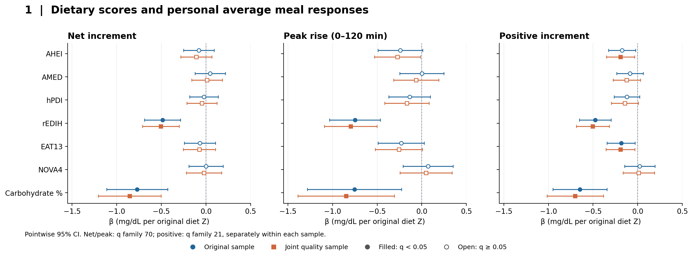
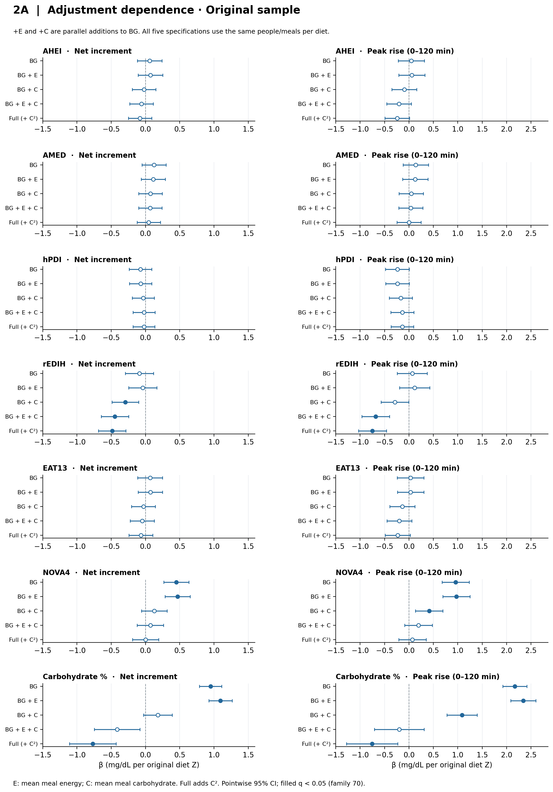
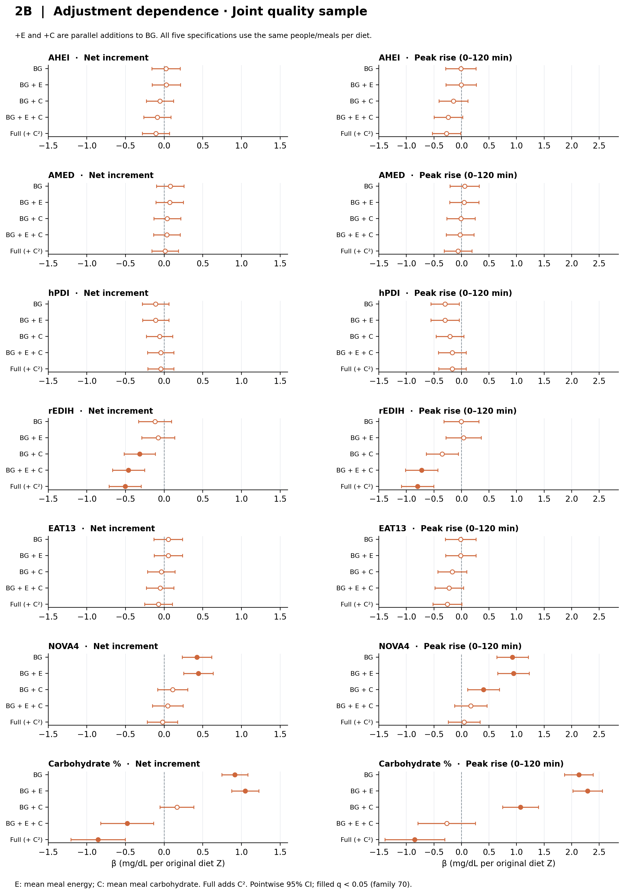
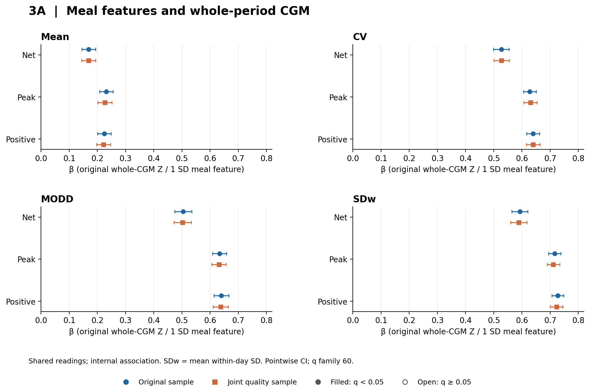
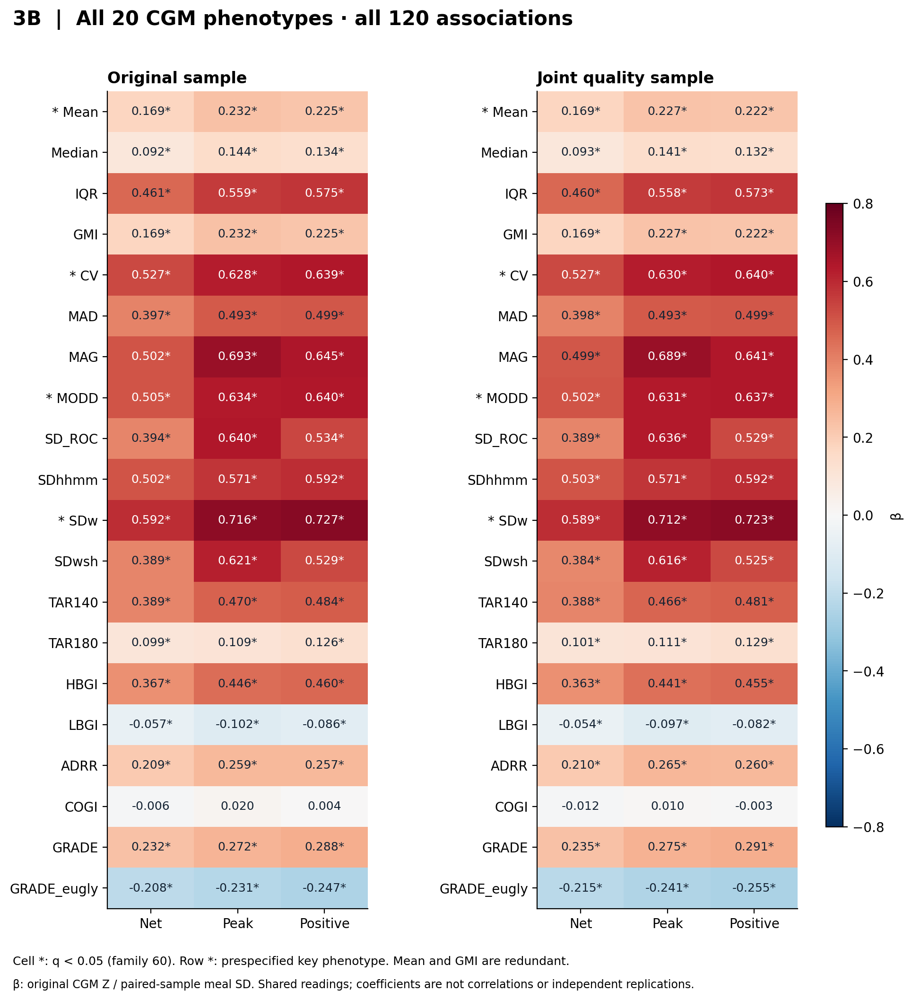
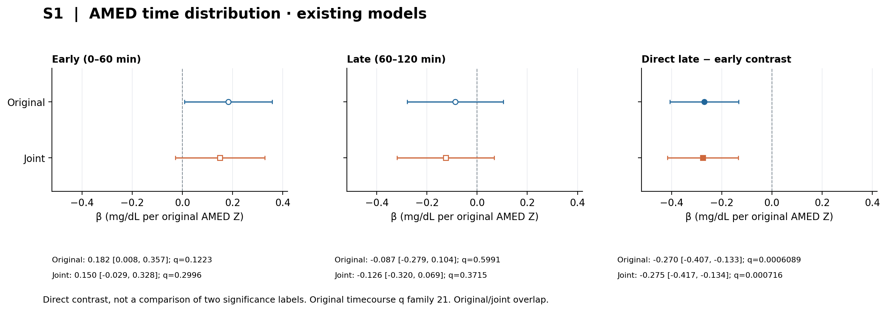

# 本地结果图表

已完成三组主图、七项完整总表和AMED补充图。数据来自已归档截图；未新增真实模型。

图1、图2使用nutrition_bridge的q家族，旧B与时间模型沿用quality_timecourse的原家族。原/joint不是独立复现。

[七项饮食证据总表](七项饮食证据总表.md) · [逐行追溯](artifact_provenance.json)

## Figure1_full_models

七项完整A模型；净/峰q家族70、正增量q家族21；两样本重叠。

[矢量PDF](Figure1_full_models.pdf) · [SVG](Figure1_full_models.svg)

## Figure2A_original

五规格相互独立展示；+E和+C是平行调整，Full在两者上加碳水平方；每项饮食样本固定，q家族70。

[矢量PDF](Figure2A_original.pdf) · [SVG](Figure2A_original.svg)

## Figure2B_joint

五规格相互独立展示；+E和+C是平行调整，Full在两者上加碳水平方；每项饮食样本固定，q家族70。

[矢量PDF](Figure2B_joint.pdf) · [SVG](Figure2B_joint.svg)

## Figure3A_key_CGM

原预定四指标的24项衔接；X为配对样本餐特征1SD，Y为整体CGM原Z。共享读数，不是独立验证。

[矢量PDF](Figure3A_key_CGM.pdf) · [SVG](Figure3A_key_CGM.svg)

## Figure3B_all20_CGM

完整120项，数值为标准化回归系数而非相关系数；原始q=0保留在追溯JSON中，图中只标阈值；Mean/GMI冗余。

[矢量PDF](Figure3B_all20_CGM.pdf) · [SVG](Figure3B_all20_CGM.svg)

## Supplement1_AMED_timecourse

使用原quality_timecourse模型的AMED早/晚和晚减早直接对比；未新拟合四时间段，q家族21。

[矢量PDF](Supplement1_AMED_timecourse.pdf) · [SVG](Supplement1_AMED_timecourse.svg)
