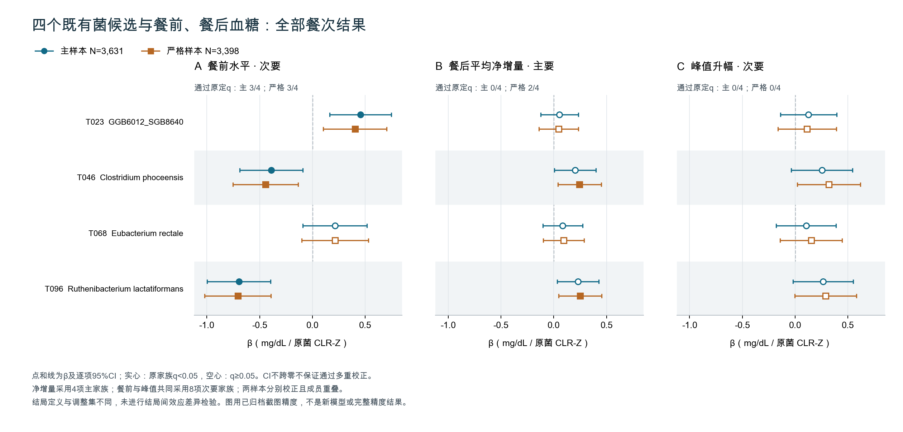

# 现有结果的综合判断与后续清单

更新至2026-09-29 14:07回传结果。范围：已完成的餐次研究、日期分离、四菌餐前餐后衔接及时间核对。本轮只整合已归档结果、核对数字并作图；没有新增拟合、重算p/q、扩大筛菌或改变原先的检验家族。

**当前最完整的研究主线是：饮食与餐前状态对应自然生活中的餐反应差异，而个人餐反应与不同日期的整体血糖波动仍有关联。菌群提供部分餐前水平的观察性补充，尚未补上“饮食→菌群→餐反应→整体CGM”的因果链。**

完整设计和全部结果见[完整报告](完整中文分析报告.md)，简报见[一页核心结论](一页核心结论.md)。以下的“主线、补充”是汇报安排，不是事后更改各模块原定的主要检验。

## 1. 这次整合后，真正增加了什么认识

### 餐前水平、餐后升幅、整体波动应分别解释

后续日期预测已经显示，加入餐前水平和趋势，相对于包含同人同食物模板历史均值、时刻和前餐间隔的模型，使主样本MAE降低0.744 mg/dL（95%CI 0.571–0.938）。这说明餐前信息对这个限定预测任务有增量价值；目标是餐后平均绝对血糖，适用于已知人和训练中已见模板。

新四菌结果又显示，T023、T046、T096与平均餐前水平有校正后关联，但主样本四菌的净增量与峰值均未通过校正。这两个模块共同提醒我们：不能把“与血糖水平有关”自动解释为“改变了食物引起的升幅”。它们并未在同一个模型中检验共同机制，显著与不显著之差也不是正式效应差异证据。

日期分离分析进一步显示，前窗餐反应与后窗CV、SDw、MODD15仍存在正向关联，波动结局的24项规格中有18项，β为0.435–0.644；其余6项是Mean，β为0.153–0.221。全部24项均通过预设合并家族q24。β按各自冻结标准差表示，数值大小可描述，不能从不同结局的β大小断言哪种生理作用更强。

以上三类证据适合形成分层叙述；当前没有证据把它们写成已经验证的连续因果步骤。

### 日期分离结果值得作为主要证据，但措辞要准确

这一分析在原样本约4,435人、joint约4,136人中，程序报告前后没有共享实际支撑读数。24项主关联都保留，比只使用同一监测期全部读数的相关更能回应“是否仅由指标构建重叠造成”的质疑。

例如正增量与后窗SDw：原样本β=0.644（0.612–0.676），joint为0.627（0.594–0.661）。18项波动关联相对同成员、同X、同尺度的新全期比较约减弱6.5%–8.8%，18项配对差值均通过次要qD24；不能把这个比例解释成共享读数偏差占比。全期包含后窗，窗口长度、测量可靠性和时间变化也可能参与差异。

这回答的是同一监测期内不同日期的关联问题，尚未回答外部人群或长期预测问题。整个项目中真正的留出预测已经由早期followup完成，但那个任务、目标与这里不同。

## 2. 饮食部分怎样保留完整结果

| 饮食指标 | 现有结果的合适定位 | 必须一同说明的限制 |
|---|---|---|
| 餐次NOVA4占比 | 同人不同餐的条件关联；每增加10个百分点，平均净增量约+0.172 mg/dL | 由净面积20.60除120换算，非20.60 mg/dL；不同于个人NOVA4评分 |
| AHEI | 完整净增量/峰值及碳水交互未获支持；正增量留作次要线索 | 原样本正增量q=0.05155、joint=0.038；不能只呈现后者 |
| AMED | 两小时平均反应无清楚支持，但晚60–120分钟减早0–60分钟有直接差值证据 | 原β=−0.2698，q=0.0006089；不能解释成证实清除加快 |
| hPDI | 完整主要结局及交互未获支持；背景正增量的负向结果在完整调整后未保留 | 使用更正评分；日记质量筛选流失较多，不能概括成已证明无作用 |
| rEDIH | 最清楚的条件性平均反应信号：原样本净/峰/正β约−0.49/−0.75/−0.48 mg/dL/原Z | 背景模型无同等支持；评分已反向，不再次反转；common7净交互q=0.07852 |
| EAT13 | 净/峰及交互未获支持；正增量为次要线索 | 原/joint正增量q约0.04956/0.03933，接近阈值且两样本重叠 |
| 个人NOVA4占比 | 背景平均反应正向，完整营养调整后未保留；所选碳水交互对比为负 | 暴露、分析层级和估计对象均不同于第一行；负交互不等于超加工有益 |
| 个人碳水供能比 | 平均反应系数随调整由正转负；碳水交互对比为负 | 固定餐碳水和能量后的条件比较，不能写成多吃碳水降低血糖 |

rEDIH、NOVA4和个人碳水评分的既有交互换算D约为−0.10至−0.36 mg/dL，AHEI、AMED、hPDI、EAT13相应交互未获支持。D是评分Q75与Q25之间“高碳水−低碳水反应差”的差，不是碳水的总效应，也不是两组人的绝对血糖差。42个D只是旧系数换算，不是42个新发现。

重复餐6.012 mg/dL的绝对配对差中位数可以用来说明日志匹配后仍有差异，却不能与上述调整斜率直接相除得到解释比例。现有研究没有估计个人反应ICC或证明某个人属于稳定的高/低反应类型。

## 3. 菌群线可以连接到哪里，哪里仍没有证据

图中保留两样本、四菌、三结局的全部24项餐次系数；主样本蓝色、strict橙色；实心表示通过该模型原定家族q<0.05，空心表示未通过。误差线为逐项95%CI。净增量采用4项家族，餐前和峰值共同采用8项家族；不同样本各自校正。CI不跨0而空心并非绘图错误。两样本重叠，结局定义与调整集不同，图不能替代结局间差异检验。

| 衔接环节 | 现有证据 | 现在能说什么 |
|---|---|---|
| 旧重点菌—整体CGM | 在本轮共同样本重拟合参照；T068与Mean/CV/SDw均为正向校正后关联 | 部分旧候选的整体血糖信号仍可观察到；不是外部复制 |
| 旧重点菌—餐前水平 | T023正向，T046/T096负向，主/strict均通过对应次要家族校正 | 与个人平均餐前状态存在条件关联；餐前不等于空腹 |
| 旧重点菌—餐后相对升幅 | 主样本净增量0/4、峰值0/4通过校正；strict净增量T046/T096 q=0.0404 | 保留样本定义敏感的线索，尚不能将主结果改称阳性 |
| 菌×餐次NOVA4 | 原先两种菌交互均未获支持 | 没有在这两个预定检验中发现斜率修饰证据 |
| 饮食→菌→餐反应→CGM | 未估计串联中介；时间与样本身份也未满足相应解释要求 | 仍是待验证的研究假设 |

菌群不需要在每餐前后反复测量才能研究“不同人的菌群与其平均餐反应是否相关”；一次测量仍可用于个人之间的关联问题。但是它不能揭示菌群随每餐的变化，也不能仅凭日历接近就被当作此前状态的准确测量。

时间核对进一步限制了解释：已知日期的主样本98.8%晚于对应CGM记录结束，间隔中位数9天、四分位范围7–12天；所有已知日期均为同访视唯一记录匹配，尚未精确匹配sample_name。我们不把“记录在后”直接当成确认的真实采集在后，也不把它解释成反向因果；目前只能使用观察性关联措辞。[日期字段的官方定义](https://knowledgebase.pheno.ai/datasets/013-gut_microbiome.html)为样本提供时间，实际采集与交样的关系仍需源记录或采集流程证据。

旧的diet–gut、gut–CGM、diet–CGM和单菌中介具有独立的分析样本及窗口。本轮98.8%不能直接推广过去，也不能为旧中介补上因果资格。不同菌的单中介比例、不同餐指标的β以及本轮前后差值不能相加成“整体解释比例”。

## 4. 本轮已经完成的本地工作

- 将原七模块总报告更新为八模块，纳入四菌餐次衔接和时间审计；保留旧版快照，历史结果没有被删除。
- 核对302项营养/全期桥接、42项交互换算、24项日期分离记录、36项可见菌群记录及四组时间计数的结构与主要数字；没有用显示精度数据反推新p/q。
- 将新四菌全部餐次结果作图，保留主样本不显著、strict才达到阈值和CI与q判定不同的情况。
- 检查本地数据可用性：没有服务器完整outputs，也没有菌群上游处理目录/CLR-Z数据。本地菌群元数据仅31行且不含参与者/队列/访视身份列，不足以进行实际样本映射核对，未用于重做研究统计。

本轮具体检查结果与引用文件指纹见[本轮整合核查](本轮整合核查.json)。它验证本地整理和作图使用的显示数字，不能代替服务器真实模型重算或独立复现。

## 5. 接下来需要上传吗

**本轮不需要上传新代码，也不需要补发已有截图。** 当前已经可以用于研究汇报、讨论和结果写作。

如果后面要升级为完整精度图表或正式稿件，只需补回影响对应主张的现成聚合表，不必重跑所有模型：

| 要完善的内容 | 最少的服务器材料 | 能解决什么，不能解决什么 |
|---|---|---|
| 预测性能的绝对量级 | 原followup运行的`tables/04_prediction_metrics.csv`、`04_prediction_flow.csv`、`04_prediction_status.csv`，配套manifest | 获得已有测试误差与筛选情况；仍不构成新人/外部验证 |
| 四菌森林图的完整精度及strict整体参照 | 已成功gut_meal_bridge_v2运行的`tables/models.csv`与manifest | 替代显示精度作图、补齐未显示12项；不能修复时间语义 |
| 日期分离投稿级完整表 | 已成功date_split_bridge运行的聚合模型结果表、analysis_spec和manifest | 补齐全期比较CI/q、冻结尺度和模型信息；不需要导出个体成员或原始CGM |
| 菌群是否能用于更强时序表述 | CLR-Z上游样本保留/聚合规则及sample_name映射核对汇总，日期字段的采集流程说明 | 确认具体样本与真实时间；仅有字段名、同访视或短间隔不能解决 |

这是后续按实际写作需要补资料的清单，不是当前新增运行要求。完整原始数据和private目录不需要为了这轮整理而上传。若继续菌群样本审计，优先在服务器核对后只回传聚合结论。

## 可用于现阶段汇报的结果表述

> 在自然生活餐次记录中，餐次NOVA4占比与小幅较高的调整后餐反应相关；日志匹配的重复餐仍存在反应差异，而餐前水平和趋势在已知参与者及已见食物模板的后续日期预测中提供增量信息。个人饮食评分的平均反应关联依赖营养调整条件，rEDIH的负向关联较清楚，部分评分还表现出碳水反应交互或早晚分布线索。前窗个人餐反应与后窗整体血糖波动的关联在程序报告排除共享支撑读数后仍保留。四个既有菌候选中，三种与平均餐前血糖相关，但主样本餐后净增量与峰值关联均未通过预定校正；菌群记录日期多数晚于CGM，且样本身份和日期语义仍需核实。因此，现有研究支持多层面的观察性关联及限定任务的预测信息，不支持将这些结果写成已验证的菌群因果中介链。
